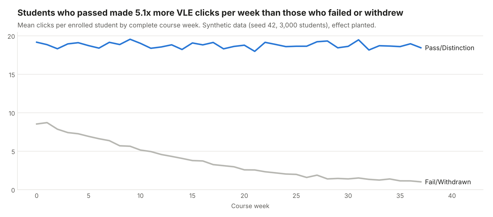
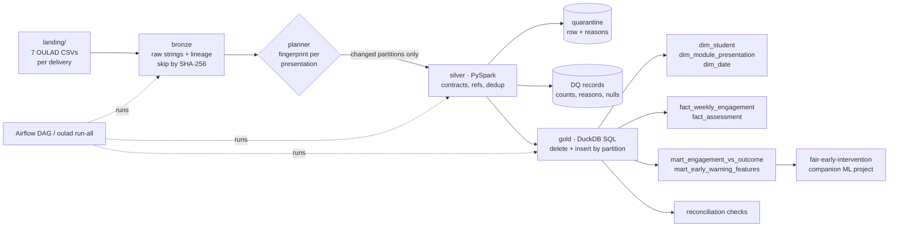
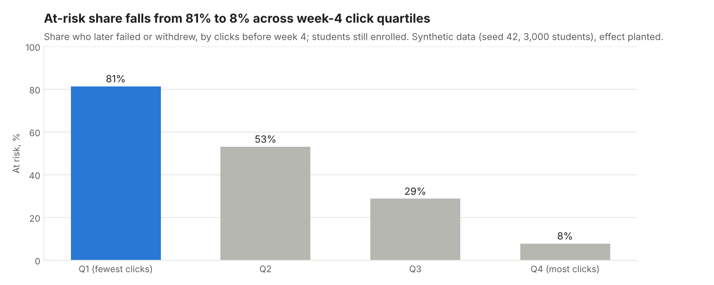

# OULAD Learning-Analytics Lakehouse


A batch data platform for online-course data, built on the
[Open University Learning Analytics Dataset](https://analyse.kmi.open.ac.uk/open-dataset) (OULAD):
**landing CSV → bronze Parquet → silver (PySpark, schema contracts, quarantine) → gold star schema
in DuckDB (SQL models) → analytics marts**, orchestrated by an Airflow DAG or one CLI command.
Every load is idempotent, a late file rebuilds only its own course presentation, and every row is
accounted for from the CSV to the marts.

**What this project shows**

- Medallion architecture done carefully: raw strings kept in bronze with lineage, typed and
  validated silver, dimensional gold.
- Data contracts with reasons: bad rows go to a quarantine table with a readable reason. On the
  synthetic data the pipeline caught all 24 planted defects and all 3,568 planted duplicates.
- Incremental loads by partition: content-hash ingestion, input fingerprints per presentation,
  delete-and-insert in gold. Proven by tests: a rerun does nothing, a late file for 2014B leaves
  2013J's files untouched.
- Reconciliation checks between layers, and a feature mart for an early-warning model with a
  test that proves it cannot see the future.



## Problem

A university wants to spot students at risk of failing early enough to help them. The data
comes from several systems (registrations, assessments, daily click logs of the virtual
learning environment) as CSV exports with gaps, `?` for unknown values and duplicate log rows.
Analysts need clean, trustworthy tables; a data scientist needs features that use only what was
known on a given day. This project builds that platform and checks itself at every step.

## Architecture



Step-by-step explanation of the code: **[docs/how-it-works.md](docs/how-it-works.md)**.
Why each choice was made: **[docs/decisions.md](docs/decisions.md)**.

## Quick start

Needs Python 3.11+ and Java 17+ (for local Spark).

```bash
python -m venv .venv && source .venv/bin/activate
make install
make demo     # synthetic data -> initial load -> no-op rerun -> late file -> report
```

Or step by step:

```bash
oulad generate                         # seeded synthetic OULAD in data/landing/<presentation>/
oulad run-all --label "initial load"   # ingest -> silver -> gold, timed, logged
oulad generate-late --presentation 2014B
oulad run-all --label "late file"      # rebuilds 2014B only
oulad report                           # docs/results.md + docs/img/*.png
```

Explore gold with DuckDB:

```bash
duckdb data/gold/oulad.duckdb "SELECT as_of_week, avg(label_at_risk::INT) FROM mart_early_warning_features GROUP BY 1"
```

**Real data:** download OULAD from the link above, put the seven CSVs in a folder under
`data/landing/` (e.g. `data/landing/oulad/`), and run `oulad run-all` then
`oulad report --data-label "OULAD"`. File and column names are the same as in the synthetic
data; bronze rejects any file whose header differs.

**Storage:** bronze and silver live in `data/lake/` by default. To use S3 or MinIO, install the
extra and point the lake at a bucket (the DuckDB gold file stays local):

```bash
pip install -e ".[s3]"
make up   # optional local MinIO on :9000 with an "oulad" bucket
export AWS_ACCESS_KEY_ID=minioadmin AWS_SECRET_ACCESS_KEY=minioadmin
export AWS_ENDPOINT_URL=http://localhost:9000 OULAD_LAKE_URI=s3://oulad/lake
oulad run-all
```

Python I/O goes through fsspec/s3fs, DuckDB reads through the same filesystem, and Spark gets
`s3a://` settings from `storage.spark_s3_conf` (it downloads `hadoop-aws` on first use). The
fsspec path is tested with an in-memory filesystem; **the MinIO setup itself was not run** in
the environment this repo was built in (no Docker there).

## Results

From `make demo` on the bundled **synthetic** data (3 presentations, 3,000 students, seed 42).
Full page: [docs/results.md](docs/results.md).

| Table | Bronze rows | Silver rows | Quarantined | Duplicates removed |
| --- | --- | --- | --- | --- |
| studentInfo | 3,003 | 3,000 | 3 | 0 |
| studentRegistration | 3,003 | 3,000 | 3 | 0 |
| studentAssessment | 13,948 | 13,942 | 6 | 0 |
| studentVle | 355,664 | 352,084 | 12 | 3,568 |

| Run | Files | Partitions rebuilt | Silver (s) | Gold (s) |
| --- | --- | --- | --- | --- |
| Initial load | 21 new | 2013J, 2014B, 2014J, `__unknown__` | 52.5 | 1.6 |
| Rerun, nothing new | 0 new, 21 skipped | none | 0.2 | 0.4 |
| Late studentVle file for 2014B | 1 new, 21 skipped | 2014B | 45.5 | 0.9 |

- All 8 reconciliation checks pass, e.g. 352,084 silver click rows and 1,353,271 clicks, all
  found in `fact_weekly_engagement`.
- Pass/Distinction students made **5.1x** as many clicks per week as Fail/Withdrawn students.
  At the start of week 4, **81%** of the least active quartile later failed or withdrew,
  against **8%** of the most active.

These effects were **planted** by the generator so the charts have something real to show;
they say the pipeline carries a signal end to end, not anything about real students. Spark time
is mostly fixed start-up and job overhead on a shared 2-CPU machine, so one partition is not
much faster than three at this size; the point of the late-file run is what it does not touch.



## Design decisions (summary)

- **Bronze keeps strings.** Nothing is lost or guessed at the edge; contracts can be fixed and
  replayed from bronze.
- **Identity by content.** A file's SHA-256 decides whether it is new, so a renamed copy is
  skipped.
- **Contracts as data, reasons as strings.** One file lists every rule; the DQ report and tests
  count the same reason strings.
- **Quarantine, don't drop.** Bad rows keep their raw values and the reason, next to the data.
- **Partition by presentation, plan by fingerprint.** Rebuild a partition when the set of files
  feeding it changes; never compare timestamps.
- **Spark for bronze → silver, DuckDB for gold.** Spark scales the heavy row-level work; DuckDB
  SQL models make the star schema easy to read and fast to rebuild.
- **Reconcile every run.** Gold fails loudly if any silver row is missing.
- **Features as of a cutoff.** Only events before day 7·N; a perturbation test proves it.

Full reasoning, costs and alternatives: [docs/decisions.md](docs/decisions.md).

## Project layout

```
src/oulad_lakehouse/
  tables.py        the 7 OULAD tables and their exact columns
  synthetic.py     seeded generator with real quirks, planted defects and a planted effect
  bronze.py        CSV -> Parquet, all strings, lineage columns, content-hash idempotency
  incremental.py   partition fingerprints and change detection
  contracts.py     silver schema contracts and reason strings
  silver.py        PySpark: contracts, references, quarantine, dedup, DQ records
  gold.py          runs sql/gold/*.sql in DuckDB (full or incremental) + reconciliation
  report.py        docs/results.md and charts from real outputs
  storage.py       local / S3 paths via fsspec, Spark and DuckDB settings
  config.py, cli.py
sql/gold/          7 SQL models: 3 dimensions, 2 facts, 2 marts
dags/              Airflow DAG calling the CLI (Airflow not a package dependency)
docs/              how-it-works, decisions, results, charts
tests/             30 tests, 97% coverage
```

## Testing and quality

- **30 tests**: exact OULAD headers and a deterministic generator; bronze lineage, idempotent
  re-ingest (also under a new file name) and header rejection; partition fingerprints; a
  non-local filesystem; and one end-to-end Spark run (initial load, no-op rerun, late file plus
  a correction) that checks quarantine reasons against what was planted, `?` handling and the
  IMD band fix, de-duplication and "latest correction wins", DQ accounting, partition-only
  rebuilds, gold reconciliation (and that it catches a lost row), relative weeks for negative
  days, and **no leakage** in the early-warning features at every cutoff, plus a positive
  control.
- Spark tests are marked `spark` (`pytest -m "not spark"` skips them) and share one local Spark
  run on a tiny dataset to keep CI fast.
- **CI** (GitHub Actions): ruff lint and format, mypy, pytest with an 80% coverage gate, Java 17
  via `actions/setup-java`, and a validation of the optional compose file.
- `pre-commit install` runs the same checks before each commit.
- The Airflow DAG is excluded from mypy and coverage because Airflow is not installed in CI; a
  test parses it and checks that it only calls CLI commands that exist.

## What I'd do next

- Delta Lake or Iceberg for silver: atomic partition replacement and time travel instead of
  delete-then-write.
- Run it on the real OULAD (about 10 million click rows) and on a small Spark cluster, and
  publish timings.
- Score the early-warning mart with a lag for marking time, not on the submission day.
- Data contracts shared with the source teams (e.g. as JSON Schema) and alerts on DQ trends.
- Wire the MinIO setup into CI with a service container.

The companion ML project **fair-early-intervention** consumes `mart_early_warning_features`.

Data: Kuzilek J., Hlosta M., Zdrahal Z. *Open University Learning Analytics dataset.* Scientific
Data 4, 170171 (2017). Licensed [CC BY 4.0](https://creativecommons.org/licenses/by/4.0/). This
repository ships no OULAD data; the bundled data is synthetic.
